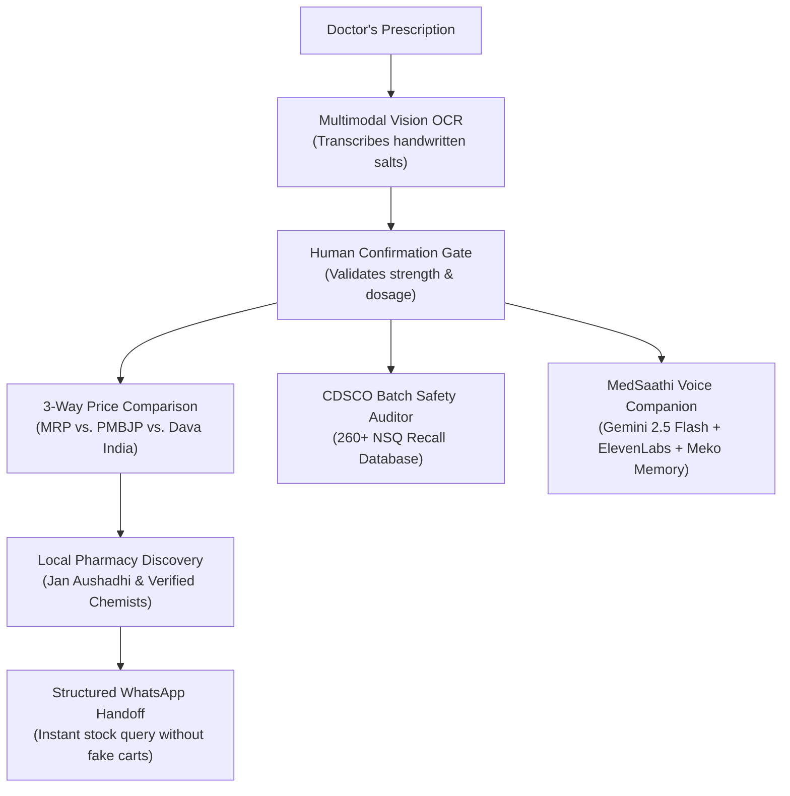

Title: Building MedEasy at hackCBS 9.0: Tackling India's Healthcare Asymmetry with Gemini 2.5 Flash, ElevenLabs, and Meko Memory

_This is a submission for the [MLH x DEV Writing Challenge](https://dev.to/mlh-hackathon)_

## What I Built

In India, out-of-pocket expenditure (OOPE) accounts for nearly 50% of all healthcare spending, forcing over 55 million citizens into medical debt every single year. Even when cost-effective generic alternatives exist—such as the Government of India's **Pradhan Mantri Bhartiya Janaushadhi Pariyojana (PMBJP)** and **Dava India** schemes, which offer identical chemical salts at 50% to 90% discounts—information asymmetry prevents patients from accessing them. Doctors' handwritten prescriptions are difficult to decipher, recall notices from the Central Drugs Standard Control Organisation (CDSCO) are buried in obscure government PDFs, and neighborhood pharmacy stock remains opaque.

To solve this, our team built **MedEasy** at **hackCBS 9.0**: an end-to-end bilingual (**English + हिंदी**) healthcare accessibility, price comparison, and clinical safety platform powered by our conversational companion, **MedSaathi (मेडसाथी)**.



### Core Architecture & Key Capabilities

1. **Multimodal Prescription OCR & Human Confirmation Gate**: Analyzes doctor prescriptions with multimodal vision models to extract active chemical salt compounds, dosage forms (*Tablet, Capsule, Syrup*), and strengths (*500 mg vs 650 mg*). Crucially, the system enforces a mandatory human confirmation step before querying our medicine database to eliminate dangerous false substitutions.
2. **3-Way Drug Price Benchmarking**: Automatically compares expensive branded medications against PMBJP Jan Aushadhi and Dava India generic equivalents, illustrating instant savings of up to 90%.
3. **Automated CDSCO NSQ Batch Recall Auditor**: Integrates an active dataset of 260+ official CDSCO *Not of Standard Quality* (NSQ) recall notices. Patients and pharmacists can scan or type a batch number to verify that a medication has not been flagged for contamination or regulatory failure.
4. **WhatsApp Local Chemist Stock Verification**: Rather than building a counterfeit e-commerce cart that cannot fulfill regulated drugs, MedEasy generates structured `wa.me/91...` deep-links so patients can verify live shelf inventory with nearby verified generic stores in one tap.
5. **MedSaathi Multimodal Voice Agent with Meko Memory**: A voice-first conversational companion in Hindi and English that answers medication questions, explains dosage directions, and tracks longitudinal patient safety across sessions.

### Key Engineering Challenges & Technical Decisions

* **Deterministic Pre-LLM Safety Routing (0ms Escalation)**: We never allow an LLM to hallucinate or hesitate during a life-threatening crisis. Before any request reaches our conversational models, our regex-based deterministic guardrail scans for emergency markers in English and Hindi (`chest pain`, `सीने में तेज दर्द`, `stroke`, `सांस नहीं आ रही`). If triggered, the system halts LLM generation immediately and displays local Indian emergency hotlines (**108 Ambulance**, **112 National Emergency**, **14416 Tele-MANAS**). It also strictly refuses requests to prescribe antibiotics or diagnose chronic conditions.
* **Zero-Storage Clinical File Privacy**: We adopted a strict volatile memory (RAM) policy: prescription images and packaging photos are processed ephemerally for OCR extraction and immediately discarded. No patient scans or protected health information (PHI) are ever stored on cloud disks.
* **Fail-Open Memory Resilience**: When integrating contextual memory for patient allergies, queries fall back gracefully if external tool calls encounter latency, preventing the UI from freezing during low-bandwidth connections.

---

## Demo

### Video Walkthrough

*(Or Loom embed: ``)*

### Core Flow in Action

| 1. Prescription OCR & Confirmation | 2. 3-Way Generic Price Comparison |
| :---: | :---: |
|  |  |

| 3. CDSCO NSQ Recall Vigilance | 4. MedSaathi Voice Assistant (Meko Memory) |
| :---: | :---: |
|  |  |

* **GitHub Repository**: [https://github.com/aparmitsrivastav01-hub/hackcbs](https://github.com/aparmitsrivastav01-hub/hackcbs)
* **Live Deployment / API Docs**: `http://localhost:8000/docs` (Swagger UI) / `http://localhost:5173` (Frontend)

---

## Partner Technologies

### 1. Google Gemini 2.5 Flash (`langchain-google-genai`)
We selected **Google Gemini 2.5 Flash** as our primary reasoning engine for both prescription multimodal vision parsing and bilingual conversational dialogue.

* **Implementation**: We configured Gemini via LangChain with low temperature (`0.2`) and strict token bounds to guarantee factual grounding and mitigate hallucinations when summarizing dosage instructions.
* **Code Snippet**:
```python
# backend/app/ai/llm/gemini_provider.py
from langchain_google_genai import ChatGoogleGenerativeAI
import os

class GeminiProvider:
    def __init__(self, api_key: str | None = None, model: str | None = None) -> None:
        self.api_key = api_key or os.getenv("GEMINI_API_KEY")
        self.model_name = model or os.getenv("GEMINI_MODEL") or "gemini-2.5-flash"
        self._chat_model = None

    @property
    def chat_model(self):
        if self._chat_model is None:
            self._chat_model = ChatGoogleGenerativeAI(
                model=self.model_name,
                api_key=self.api_key,
                temperature=0.2,
                max_output_tokens=900,
            )
        return self._chat_model
```
* **Trade-Off**: We considered larger frontier models like Gemini 1.5 Pro, but Gemini 2.5 Flash gave us the rapid ~500ms time-to-first-token necessary for snappy interactive voice conversations on low-bandwidth mobile devices.

---

### 2. Meko MCP Memory Layer
To solve the "stateless AI" problem where returning elderly patients receive generic recommendations that ignore their history, we integrated **Meko's Model Context Protocol (MCP)** server.

* **Implementation**: When users opt into health memory, MedSaathi connects to Meko's MCP endpoint (`https://mcp.mekodata.ai/mcp`) using `context_search` and `memory_search` to recall clinical notes and known drug allergies.
* **The "Remembering Changes the Outcome" Demo**: 
  * **Meko OFF**: 62-year-old Ramesh asks for a sore-throat antibiotic. The agent provides standard advice without knowing his medical history.
  * **Meko ON**: The agent queries Meko, retrieves Ramesh's documented **Penicillin anaphylaxis** from previous sessions, and immediately issues a safety intercept warning against beta-lactam antibiotics like Amoxicillin.
* **Code Snippet**:
```python
# backend/app/ai/memory/meko_memory.py
async def recall(self, query: str, conversation_id: str | None = None) -> MemoryContext:
    args: dict[str, Any] = {"query": query, "agent_id": self.agent_id, "limit": 5}
    if conversation_id:
        args["conversation_id"] = str(conversation_id)

    items: list[MemoryContextItem] = []
    try:
        context_result = await self.client.call_tool("context_search", args)
        payload = _result_payload(context_result)
        items.extend(_memory_items(payload))
    except Exception as exc:
        logger.warning("Meko context_search failed (fail-open): %s", type(exc).__name__)

    # Priority boost for clinical symptoms & allergy history
    if HEALTH_INQUIRY_PATTERN.search(query):
        items.sort(key=lambda it: 0 if HEALTH_KEYWORDS_PATTERN.search(it.text) else 1)

    return MemoryContext(items=items[:8])
```
* **Trade-Off**: We strictly gated Meko behind an explicit user consent toggle (`MEKO_CONSENT_DEFAULT=false`), ensuring patient data is never logged without active permission.

---

### 3. ElevenLabs Multilingual v2
Many citizens across Tier-2/Tier-3 cities and rural India face literacy hurdles when reading long medication labels. We integrated **ElevenLabs Multilingual v2** to give MedSaathi an empathetic, culturally responsive voice in both Hindi and English.

* **Implementation**: Text responses generated by Gemini are cleaned of markdown formatting and streamed to ElevenLabs for natural, human-like voice playback.
* **Code Snippet**:
```python
# backend/app/services/elevenlabs_service.py
from elevenlabs.client import ElevenLabs

class ElevenLabsSpeechService:
    def __init__(self, api_key: str | None = None, voice_id: str | None = None):
        self.api_key = api_key or os.getenv("ELEVENLABS_API_KEY")
        self.voice_id = voice_id or os.getenv("ELEVENLABS_VOICE_ID")
        self.model_id = os.getenv("ELEVENLABS_MODEL_ID") or "eleven_multilingual_v2"

    def _generate_blocking(self, text: str, language: str) -> bytes:
        client = ElevenLabs(api_key=self.api_key, timeout=35)
        audio_stream = client.generate(
            text=text[:2500],
            voice=self.voice_id,
            model=self.model_id
        )
        return b"".join(audio_stream)
```
* **Trade-Off**: Real-time voice generation adds latency. To maintain responsiveness, we capped payload lengths to 2500 characters and implemented automatic browser speech synthesis fallback if the ElevenLabs quota or network window times out.

---

### 4. YugabyteDB Aeon (Distributed SQL)
We utilized **YugabyteDB Aeon** as our cloud relational database for medicine pricing schemas, CDSCO safety entries, and user accounts.

* **Implementation**: Connected through asynchronous SQLAlchemy and `asyncpg` with custom SSL contexts to enforce encrypted, geo-distributed data persistence compatible with the PostgreSQL wire protocol.
* **Code Snippet**:
```python
# backend/app/db/base.py
def normalize_database_url(url: str | None) -> tuple[str, dict]:
    connect_args = {}
    if not url:
        return "sqlite+aiosqlite:///medeasy_accounts.db", connect_args

    clean_raw = "".join(url.splitlines()).strip()
    parsed = urlparse(clean_raw)
    scheme = "postgresql+asyncpg" if parsed.scheme in ("postgresql", "postgres") else parsed.scheme

    if "yugabyte" in (parsed.hostname or "").lower():
        ssl_ctx = ssl.create_default_context()
        connect_args["ssl"] = ssl_ctx

    return urlunparse(parsed._replace(scheme=scheme)), connect_args
```

---

## Hackathon Experience

Building MedEasy at **hackCBS 9.0** (hosted at Shaheed Rajguru College of Applied Sciences for Women, University of Delhi) was an exhilarating 36-hour sprint. 

Our team set out to tackle a problem deeply personal to millions of Indian families: navigating exorbitant prescription bills and confusing medical paperwork. One of our most memorable technical hurdles occurred around 3:00 AM on Day 2, when we wrestled with chaining Gemini's multimodal vision OCR with Meko's MCP memory retrieval. We realized that passing unvalidated OCR extractions directly into our conversation history could pollute the patient's long-term health record with misread dosage strengths. This sparked our breakthrough design: the **Human Confirmation Gate** and **Provenance Classification** (`patient_reported` vs. `verified`).

Collaborating in the bustling hackathon hall alongside mentors, staying fueled by midnight chai runs, and seeing MedSaathi successfully speak in Hindi to warn our demo persona "Ramesh" about his penicillin allergy made every hour of intense debugging worth it. HackCBS 9.0 gave us the collaborative environment to take MedEasy from an ambitious whitepaper idea to a tangible, life-saving application.

